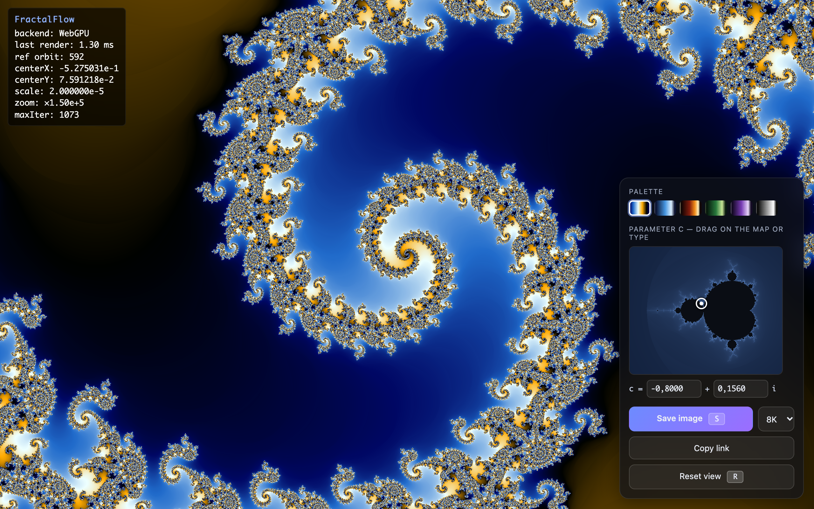
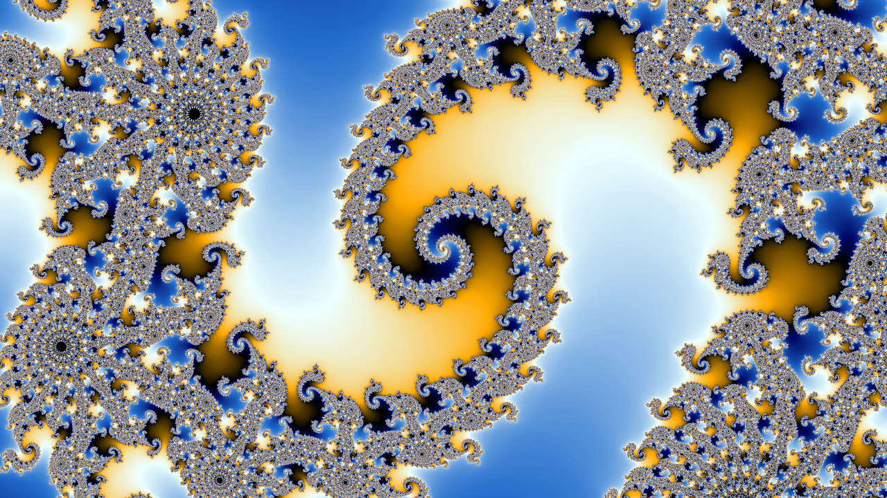
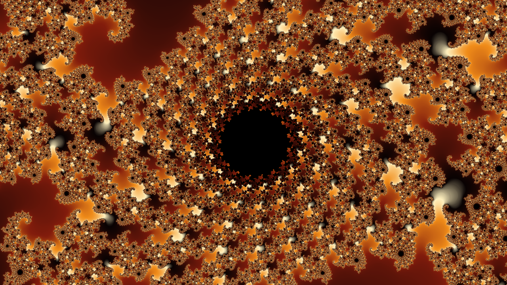
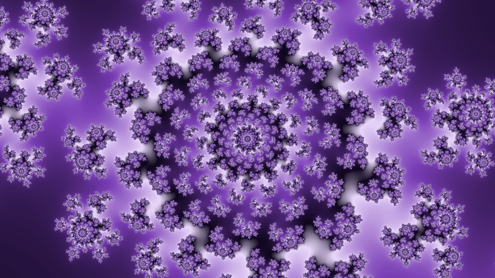
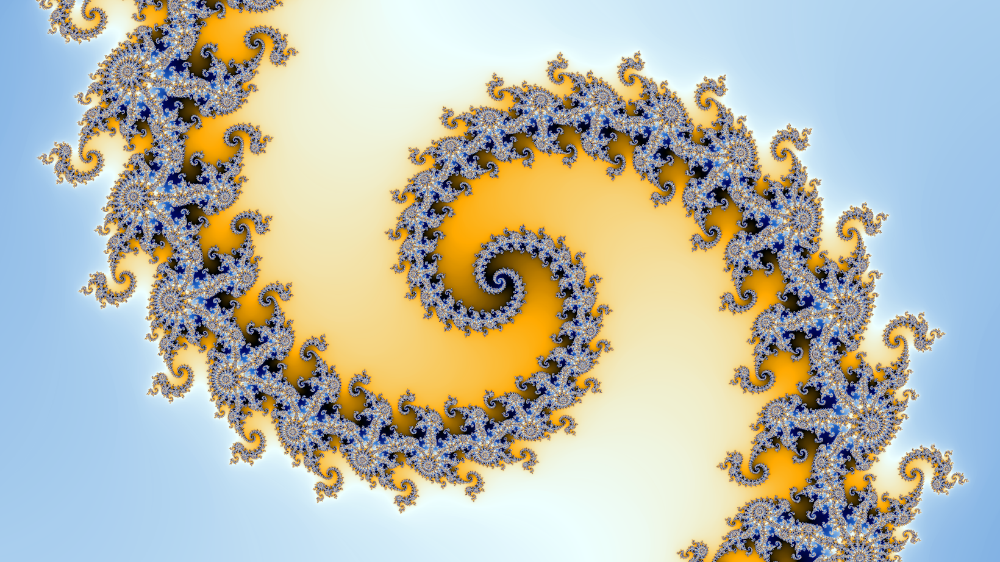
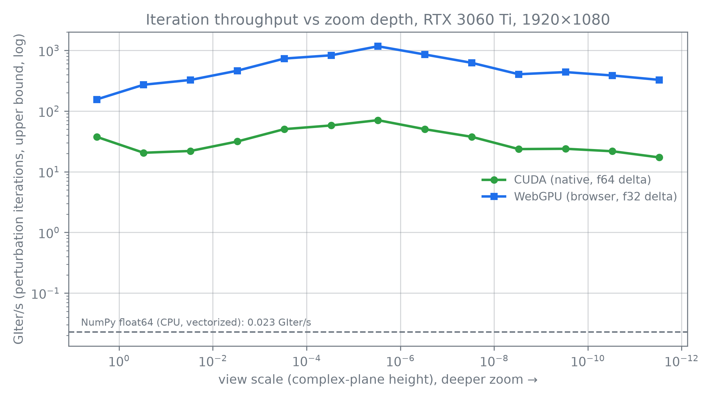
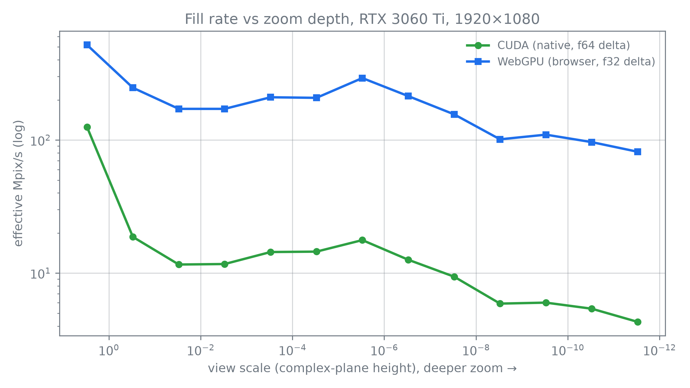

# FractalFlow

[](https://github.com/Timmor77/FractalFlow/actions/workflows/ci.yml)
[](LICENSE)


[](paper/main.pdf)

A Julia set explorer that zooms, in the browser, down to a view height of
10⁻²⁰. Past about 10⁻¹³ plain `float64` arithmetic can no longer tell neighbouring
pixels apart, so the deep zoom runs on *perturbation theory*, implemented twice: in
**WGSL** for WebGPU, and in **CUDA C** for NVIDIA GPUs. Both are checked pixel by
pixel against an independent arbitrary-precision reference. Browsers without WebGPU
get a direct **GLSL** renderer, which only goes as deep as its arithmetic allows.

**[▶ Open the live demo](https://timmor77.github.io/FractalFlow/)** (WebGPU in
Chrome and Edge, WebGL2 elsewhere).

<p align="center">
  <!-- Shown at half its 1600 px width, so it stays sharp on high-density screens.
       Frames rendered by the WebGPU backend along the script's camera path at 4800×2700,
       averaged 3×3 in linear light, then assembled with make_zoom_gif.py --frames-dir.
       AVIF with every frame a keyframe: Safari plays a WebP or inter-coded AVIF this
       large at 1 to 3 frames per second. -->
  
</p>

*From the whole set to ×10¹⁵ in ten seconds, rendered by the WebGPU backend. The
counter shows the magnification; direct `float64` iteration gives out near ×10¹³.*

## Highlights

- **Deep zoom to 10⁻²⁰, a measured limit.** In a 1080-row frame, direct iteration
  stops separating pixels below ~10⁻⁴ in `float32` and ~2×10⁻¹³ in `float64`.
  Perturbation with a double-double reference orbit gives the CUDA renderer an
  exact match with arbitrary precision at 10⁻¹⁶, and a handful of differing
  boundary pixels at 10⁻²⁰. The camera stops there, where the evidence stops
  ([depth sweep](paper/data/validation/depth_sweep.csv)).
- **One recurrence, two perturbation backends**: a WGSL fragment shader (WebGPU,
  `f32` deltas) and a native CUDA kernel (`f64` deltas). The WebGL2 renderer
  iterates directly and is *not* part of the deep-zoom pipeline.
- **Validated, not eyeballed**: every backend is compared with an independent
  `mpmath` arbitrary-precision implementation, on raw escape times as well as
  colours. This caught a real off-centre rebasing bug during development, and
  later a second one in the native path's orbit encoding
  ([Correctness](#correctness)).
- **16K export from the browser**: the picture is rendered in tiles and written by
  a streaming PNG encoder, so its size is not bounded by the GPU's largest texture
  (15360×8640 on a device whose limit is 8192). A tiled export is pixel-identical
  to a single draw ([Export](#export)).
- **Measured**: a nominal 1 168 GIter/s in the browser on an RTX 3060 Ti. That
  convention charges every pixel the full iteration cap; the machine really issues
  about 7% of it ([benchmarks below](#benchmarks)).
- **Reproducible**: frozen measurements with a hashed manifest, a
  [technical report](paper/main.pdf) built from them, 84 unit tests, and a CI
  that lints, type-checks, tests and re-verifies the archived evidence.

<p align="center">
  
</p>

*The app at ×150 000, centred on a repelling fixed point. Top left: backend, frame
time, reference-orbit length. Bottom right: palettes, a mini-Mandelbrot map to pick
the Julia parameter `c`, PNG export, shareable link.*

## Gallery

<p align="center">
  <!-- 1640 px preview of the 3840 px plate, shown at half size; the link opens the original. -->
  <a href="docs/renders/hero-4k.png">
    
  </a>
</p>

*`c = 0.285 + 0.01i`, centred on its repelling fixed point at a view height of
`1e-12`, a **3×10¹¹ magnification**. Rendered by the CUDA backend at 7680×4320
with 2 600 iterations and downsampled to 4K; [click for the full-resolution
file](docs/renders/hero-4k.png). Direct `float64` iteration cannot separate
neighbouring pixels at this depth.*

Four values of `c`, each framed on the repelling fixed point around which its set
winds. Each image opens the live demo on that exact view: the centre, zoom, `c` and
palette travel in the URL, which is how the app shares a view.

<table>
  <tr>
    <td align="center">
      <a href="https://timmor77.github.io/FractalFlow/#x=-0.5275031186435346_-3.232802264249084e-18&y=0.07591217835228786_4.701141084336033e-18&s=0.6&cx=-0.8&cy=0.156&p=0"></a><br>
      <code>c = -0.8 + 0.156i</code>
    </td>
    <td align="center">
      <a href="https://timmor77.github.io/FractalFlow/#x=0.4735372956181479_-1.63420744652396e-17&y=0.18894516327019673_-5.414053782055223e-18&s=0.25&cx=0.285&cy=0.01&p=0"></a><br>
      <code>c = 0.285 + 0.01i</code>
    </td>
  </tr>
  <tr>
    <td align="center">
      <a href="https://timmor77.github.io/FractalFlow/#x=-0.4929491148691219_-1.6587234810528338e-17&y=0.09512068502367235_-3.955202270985088e-18&s=0.6&cx=-0.7269&cy=0.1889&p=2"></a><br>
      <code>c = -0.7269 + 0.1889i</code>
    </td>
    <td align="center">
      <a href="https://timmor77.github.io/FractalFlow/#x=-0.37595385170901174_1.2867535475977852e-17&y=0.34248379570988946_2.2448871183964795e-17&s=0.6&cx=-0.4&cy=0.6&p=4"></a><br>
      <code>c = -0.4 + 0.6i</code>
    </td>
  </tr>
</table>

## Why perturbation theory?

Zooming far into a fractal is a *precision* problem. Adjacent pixels in a 1080-row
frame of height `s` are `s/1080` apart, and around `|z| = 1` consecutive `float32`
values are ~`1e-7` apart, `float64` values ~`2e-16`. Direct iteration therefore
stops separating neighbouring pixels below a view height of ~`1e-4` in `float32`
and ~`2e-13` in `float64` (sooner at higher resolution, later near the origin).
The trick that unlocks real depth is **perturbation**:

1. Compute the orbit of a single **reference point** (the view centre) **once on the
   CPU** in high precision (double-double, ~31 digits).
2. Every pixel then tracks only a tiny **delta** `δ` from that reference, in cheap
   `f32` (WebGPU) or `double` (CUDA).

For a Julia set `c` is constant, so the delta recurrence has **no `δc` term** and stays
beautifully simple:

```
z_n = Z[m] + δ                     // full value (Z = reference orbit)
δ'  = 2·Z[m]·δ + δ²                // advance the delta
```

Glitches and an escaping reference are handled with **Zhuoran rebasing**: when `δ` loses
precision (`|z − Z₀| < |δ|`) or the reference runs out, we restart from `Z[0]` with
`δ = z − Z₀`. The GPU never forms a pixel's exact coordinate as `centre + tiny offset`
in low precision: it gets the reference orbit and a small per-pixel delta. That is
why the shader is *simpler* than a naïve high-precision one, and much faster.

One subtlety, and the bug that took longest to find: the reference orbit is uploaded
**relative to Z₀** (`D[m] = Z[m] − Z₀`, subtracted in double-double). Absolute orbit
values would quantise the rebased delta `D[m] + δ` to the grid of O(1) numbers in the
upload format: ~`1e-7` in `f32`, ~`2e-16` in `f64`. Near a fixed point, where deltas
shrink with the zoom, neighbouring pixels then collapse onto the same delta and the
image dissolves into blocky noise: from ~`1e-5` down in the browser, from ~`1e-13` down
in CUDA. As offsets, both terms are small exactly when precision matters. Rendering the
same `1e-16` view with the absolute encoding misses **3 509 of 4 096 pixels**; with the
relative encoding it matches arbitrary precision **exactly**.

The high-precision centre is stored as a **double-double** value (two `float64`s, where
the second holds the rounding error of the first), giving ~31 digits. The camera's floor
is `1e-20`: not the representation's limit, but the deepest scale where the frozen
validation still holds (see [Correctness](#correctness)).

<p align="center">
  
</p>

*Rendered in the browser by the WebGPU backend at a view height of `3e-14` (×10¹⁴),
where direct `float64` iteration no longer separates pixels. The centre is the
repelling fixed point of `z² + c` near `−0.53 + 0.08i`: it lies on the Julia set, so
there is structure at every depth. Around it, `z² + c` turns the plane by 172° while
stretching it by only 1.07, which winds the set into this spiral.*

## Architecture

```
src/
  core/
    doubleDouble.ts     # double-double arithmetic (TwoSum / Dekker TwoProd)
    viewport.ts         # camera: DD centre, inertial zoom-at-cursor, pan
    referenceOrbit.ts   # perturbation reference orbit (shared idea across backends)
    frameLoop.ts        # render on demand: reduced resolution in motion, one sharp frame at rest
    resolutionGovernor.ts  # that resolution, paced on the display's frame time
    urlState.ts         # shareable view <-> URL hash
    types.ts            # Renderer interface + ViewState
    config.ts           # shared constants (c, iteration counts, export sizes)
  backends/
    webgpu/             # primary: perturbation fragment shader in WGSL (f32)
    webgl/              # fallback: direct double-single shader in GLSL + driver probe
  export/               # tiled export: tile layout, streaming PNG encoder, orchestration
  bench/                # in-browser benchmark (/?bench) and validation (/?validate) harnesses
  controls/             # wheel / drag / pinch / keyboard → viewport
  ui/                   # palettes, Mandelbrot c-picker, stats overlay, panel, messages
  main.ts               # picks WebGPU, falls back to WebGL2, wires the modules
cuda/
  julia.cu              # native renderer + benchmark (DD host orbit, f64 deltas)
scripts/
  reference_julia.py    # mpmath ground-truth renderer (validation) + CPU baseline
  validate_release.py   # the release matrix: CUDA vs mpmath, with thresholds
  benchmark.py          # benchmark CSVs → summary + charts
  make_zoom_gif.py      # the hero animation's camera path, rendered via CUDA or assembled
paper/                  # technical report: source, frozen data, generated figures
tests/                  # vitest suite (math core, camera, export, encoder, loop)
```

A backend implements one small interface (`Renderer` in
[`core/types.ts`](src/core/types.ts)): draw the view on the canvas, and draw one
tile of a larger picture off-screen. Everything else (camera, loop, export, UI)
is backend-agnostic and unit-tested without a GPU.

| Backend | Delta precision | Zoom floor | Role |
|---------|-----------------|------------|------|
| WebGPU  | `f32`, DD centre, relative orbit | `1e-20` (validated depth of the shared pipeline) | Primary browser renderer |
| CUDA    | `double`, DD centre, relative orbit | `1e-20`, exact match at `1e-16`, degrades past `1e-24` | Native renderer + benchmark |
| WebGL2  | double-single (`f32²`), direct iteration, no perturbation | `1e-13`, or `1e-4` when the start-up probe finds the compensated arithmetic optimised away | Shallow compatibility fallback, outside the validated pipeline |

## Export

"Save image" produces a PNG of the current view at 4K, 8K or 16K (longest side).
Drawing 132 million pixels at up to 4 000 iterations each in one draw call is not an
option: it would keep the GPU busy for seconds, long enough for a driver watchdog to
reset it on modest hardware, and a 16K render target does not exist on a device whose
largest texture is 8192. So the export never holds the picture whole:

- the GPU draws **512-pixel tiles** into a small off-screen target. The shader maps
  pixels from the full image size plus the tile's origin; both are small integers, so
  the sum is exact in `f32` and a tile gets bit-for-bit the coordinates of a single
  full-size draw;
- tiles are gathered into a horizontal band, handed to a **streaming PNG encoder**
  ([`src/export/pngEncoder.ts`](src/export/pngEncoder.ts): adaptive row filtering,
  chunking and CRC written here, deflate from the platform's `CompressionStream`),
  and dropped. Peak memory is one band plus the compressed output;
- the interactive loop is paused meanwhile, progress is shown on the button, and the
  export can be cancelled (`Esc`).

Measured on both backends: a tiled export and a single-draw export of the same view
differ by **zero pixels**, and the browser's own PNG decoder returns exactly the
pixels that went in. On an Apple M5 Pro a 16K export (15360×8640, 510 tiles) of a
4 000-iteration view takes 5.7 s and yields a 96 MB file; the device's texture limit
is 8192.

## Benchmarks

Same view, schedule and counting convention on both GPU backends: 13 zoom depths from
`3` down to `3×10⁻¹²`, `maxIter = min(300 + 800k, 4000)`, at 1920×1080, on an
**RTX 3060 Ti**. Not the same *work*, though: the precisions differ by design, the
timing methods differ (see below), and the CPU baseline is a single shallow anchor
with colouring excluded.



The counter-intuitive headline: **the browser out-runs native CUDA by ~16×** here.
Not magic, and not a browser-versus-native result: the WebGPU shader iterates deltas
in `f32` while the CUDA kernel uses `f64`, and consumer Ampere executes fp64 at 1/64
of the fp32 rate. The measured gap is far *smaller* than that 64:1, because the `f32`
kernel is nowhere near its arithmetic ceiling (divergence and control flow dominate)
while the `f64` one is close to its own. That trade is what perturbation exploits: do
the precision-critical work once on the CPU, let the GPU crunch cheap deltas.



Peak numbers, both at `scale = 3×10⁻⁶`: **1,168 GIter/s / 292 Mpix/s** (WebGPU,
f32) vs **70.8 GIter/s / 17.7 Mpix/s** (CUDA, f64), against **0.023 GIter/s** for
vectorized NumPy float64. The nominal CPU→GPU ratio is ~51 000×, but NumPy has no
early exit while the GPU rate charges iterations that never ran. Correcting for
that (see below) puts the honest ratio nearer ~2 000×.

These figures were recorded for release 1.2.0. The WGSL loop has since been tightened
(it reads the reference orbit once per iteration instead of twice, with bit-identical
output), which lowered frame times by about 10% at the deep end of the schedule on an
Apple M5 Pro. The RTX 3060 Ti was not re-measured, so the charts above understate the
current shader by an unknown margin.

<details>
<summary><b>Methodology & how to reproduce</b></summary>

- The browser reports the median of 5 frames after 3 warm-ups per depth, timed with
  `device.queue.onSubmittedWorkDone()` on an off-screen render target (submission
  overhead included). CUDA reports the mean of 3 renders after 1 warm-up, with CUDA
  events around the kernel only. The CPU baseline times the vectorized iteration
  alone (colouring excluded).
- GIter/s counts `pixels × maxIter` and is therefore an *upper bound* (escaped pixels
  stop early). The convention is identical across backends, so backend-to-backend
  comparisons hold. How large the gap is: at the peak depth the average pixel escapes
  after 159 of the 4000 permitted iterations, i.e. 4%. Measure it yourself with
  `python scripts/reference_julia.py --escape-stats`.
- The reference orbit is excluded from the timed region on both paths: cached in the
  browser, recomputed and uploaded before the events on CUDA. So these numbers are the
  cost of *redrawing* a view, not of opening a new one: a fresh view adds one CPU
  double-double orbit (a few ms at the iteration cap) plus its upload.
- The browser run starts with an overhead probe: the same measured path at
  `maxIter = 1`, where the shader does nothing. What it reports is command encoding,
  submission and the wait, a fixed cost inside the browser timing that CUDA's event
  window excludes. Correcting for it would widen the browser's lead, not narrow it.
- Every sample includes a mean-luma readback to reject silently-black frames, and the
  WebGPU adapter/browser identity is recorded in its CSV header; the full host,
  driver and CUDA environment is frozen in `paper/data/environment.json`.
- The WebGL2 fallback is deliberately **excluded** from the charts: under ANGLE/D3D11
  its double-single compensated arithmetic is compiled with fast-math and collapses to
  plain `f32`, so beyond shallow depths its output no longer matches the validated
  backends, and throughput of a wrong image is meaningless. The app now detects this
  at start-up (a 1×1 probe shader), warns in the console and caps the zoom accordingly.
  On this machine the probe fails, which is why the fallback stops at `1e-4` here.
- One machine, one driver, one browser build. These curves rank two implementations on
  one desktop, not WebGPU against CUDA in general.

```bash
# 1) CUDA (writes artifacts/cuda_bench.csv)
cuda/julia.exe --bench --w 1920 --h 1080 --out artifacts/cuda_bench.csv

# 2) Browser: npm run dev, open http://localhost:5173/?bench,
#    download the CSV(s) into artifacts/

# 3) CPU baseline (writes artifacts/cpu_bench.csv)
uv run python scripts/reference_julia.py --bench

# 4) Charts (writes docs/bench_giter.png, docs/bench_mpix.png)
uv run python scripts/benchmark.py
```

</details>

## Correctness

### CUDA against arbitrary precision

The CUDA perturbation renderer is checked pixel-for-pixel against direct
arbitrary-precision iteration (`mpmath`, 50–90 digits) in six frozen 64×64 cases.
Each image is 4096 pixels; the release gate fails on a mean above 3 levels, on more
than 1% of pixels differing by more than 4 levels, or on more than 0.5% of
escaped/not-escaped flips.

| Case | Scale | Mean error | Pixels differing | By >4 levels |
|---|---|---|---|---|
| Overview | `3` | 0.0002 | 2 | 0 |
| Off-centre boundary | `3e-1` | 0.1695 | 24 | 11 |
| Deep zoom | `1e-5` | 0.0002 | 2 | 0 |
| Repelling fixed point | `1e-10` | **0** | **0** | 0 |
| Below binary64 | `1e-16` | **0** | **0** | 0 |
| Deepest validated | `1e-20` | 0.1442 | 20 | 9 |

Colours are compared, but they are not the only thing compared: both renderers also
emit the raw smooth iteration count (`julia.exe --raw`), and the harness checks that
directly, with a tolerance of 0.01 iterations. That separates arithmetic from
palette: the two pixels that differ in the overview case turn out to have *identical*
escape times, so that difference is colour rounding and nothing else.

Two cases match the arbitrary-precision reference *exactly*, including one four orders
of magnitude below what `float64` coordinates can address. The remaining differences
sit on escape-time boundaries where neighbouring pixels differ by hundreds of
iterations, so a one-ulp difference in the delta moves the colour a long way. Past the
frozen matrix, the archived
[depth sweep](paper/data/validation/depth_sweep.csv) shows the pipeline degrading
gracefully: ~3% of pixels wrong at `1e-24`, visibly broken at `1e-28`. That is why the
camera stops at `1e-20`.

### WebGPU against the same references

The browser path is measured the same way, on the same quantity. The shader has a
second output (`fsRaw` in [`julia.wgsl`](src/backends/webgpu/julia.wgsl)) that writes
each pixel's smooth iteration count to a float target, sharing the iteration with the
colour path; the references archive their own counts next to each PNG
(`*_reference.f32`). `npm run dev`, then `/?validate`, renders the six cases, compares
escape times and prints a verdict:

| Case | Scale | Interior flips | More than 1 iteration off | Median error (iterations) |
|---|---|---|---|---|
| Overview | `3` | 0.39% | 0.39% | 1×10⁻⁷ |
| Off-centre boundary | `3e-1` | 0.02% | 8.96% | 2×10⁻⁵ |
| Deep zoom | `1e-5` | 0 | 0.02% | 0 |
| Repelling fixed point | `1e-10` | 0 | 0.02% | 6×10⁻⁵ |
| Below binary64 | `1e-16` | 0.95% | 1.32% | 2×10⁻⁴ |
| Deepest validated | `1e-20` | 2.03% | 10.21% | 4×10⁻⁴ |

*Apple M5 Pro (Metal), Chromium 156.
[data](paper/data/validation/webgpu_validation_apple_m5_pro.csv).*

Read it in two parts. The **median** error is at most 4×10⁻⁴ of an iteration: nothing
is systematically off; an off-by-one in the count or a shifted pixel grid would move
it to about 1. The **tail** is chaos: near the Julia set a rounding error doubles
every iteration or so, and a pixel that needs hundreds of iterations to escape has
forgotten its `f32` low bits long before. The two cases that sit on the boundary at
high iteration counts therefore have up to 10% of their pixels more than one iteration
off; CUDA's `f64` deltas, in the same two cases, leave 0.5–0.6% of pixels off by more
than a hundredth of an iteration. The gate (median ≤ 0.01 iteration,
≤ 15% of pixels more than one iteration off, ≤ 3% interior flips) is a regression
test set above these measurements, not a claim that `f32` is exact. Interpret the
browser as the fast path, CUDA as the accurate one.

The [RTX 3060 Ti record](paper/data/validation/webgpu_validation.csv) cited in the
report predates this harness: it compares colours only, with the earlier palette
table, and has not been re-measured.

### What validation caught

Two real bugs. First, the rebasing step must restart with `δ = z − Z₀`, not `δ = z`:
the two are only equal when `Z₀ = 0` (the Mandelbrot case), so the mistake was
invisible at the origin and only showed up in off-centre deep zooms. Second, the CUDA
kernel used to upload the reference orbit in absolute coordinates, which quantised the
rebased delta below ~`1e-13`; the `1e-16` case above scores 3 509 wrong pixels out of
4 096 with that encoding and 0 with the relative one.

### Unit tests and CI

Everything that does not need a GPU is covered by a [vitest suite](tests/README.md)
of 84 tests: the double-double arithmetic against exact BigInt ground truth
(`hi + lo === a·b` for 50-bit integer products), the camera's zoom-at-cursor invariant
through full animated zooms, the PNG encoder against a decoder written independently
from the specification, the tile layout, the render loop on a fake clock, shared
links, the palette table, and a guard that the constants written by hand in WGSL,
GLSL, CUDA and Python still agree.

CI runs the linters (ESLint with type information, Prettier, ruff), the type-checker,
the tests and the production build, then re-derives the arbitrary-precision
references from source and checks every archived file of the report against its
manifest. The GPU kernels themselves cannot run on a hosted runner; they are
validated by the two harnesses above.

## Run it: browser

```bash
npm install
npm run dev        # open the printed localhost URL
npm run check      # type-check, lint, format check, tests
```

WebGPU is used when available (Chrome, Edge, recent Firefox/Safari); otherwise it falls
back to WebGL2 automatically. The active backend is shown in the on-screen stats.

**Controls:** mouse wheel = zoom to cursor · click-drag = pan · touch: one finger =
pan, pinch = zoom · keyboard: arrows = pan, `+` / `-` = zoom · `R` = reset ·
`S` = save PNG (`Esc` cancels).

The bottom-right panel offers colour palettes, a mini-Mandelbrot map to pick the
Julia `c` (drag the marker or type values), PNG export at 4K / 8K / 16K, and a
**shareable link**: the view (centre, zoom, `c`, palette) lives in the URL hash.

Two more pages, for measurements: `/?bench` (throughput across zoom depths) and
`/?validate` (WebGPU against the archived references; dev server only, since the
reference data lives in the repository).

## Run it: CUDA (NVIDIA)

Requires the CUDA Toolkit (`nvcc`) and a host C++ compiler (see [cuda/README.md](cuda/README.md)).

```bash
cd cuda
nvcc -O3 julia.cu -o julia

# Render a PNG (full view):
./julia --w 1600 --h 1600 --iter 500 --scale 3 --out ../artifacts/cuda.png

# Deep zoom (centre accepts high-precision decimal strings, parsed to double-double):
./julia --re 0.0304 --im -0.564 --scale 6e-3 --iter 2500 --out ../artifacts/zoom.png

# Benchmark throughput across zoom depths (writes a CSV):
./julia --bench --w 1920 --h 1080 --out ../artifacts/cuda_bench.csv
```

## Run it: Python tooling (`uv`)

Python provides an **independent ground truth** to validate the GPU backends.

```bash
uv sync

# High-precision (mpmath) reference, compared to a CUDA render of the same view:
uv run python scripts/reference_julia.py --hp --w 64 --h 64 \
    --scale 1e-5 --re 0.0304 --im -0.564 --iter 700 \
    --compare artifacts/cuda_deepval.png

# CPU baseline for the benchmark charts:
uv run python scripts/reference_julia.py --bench

# CPU-only self-check (float64 vs mpmath), what CI runs:
uv run python scripts/reference_julia.py --selftest

# Full release matrix (needs the CUDA binary), and the depth sweep behind the floor.
# Adding --case <id> re-runs one case into a separate working file, without
# touching the frozen matrix:
uv run python scripts/validate_release.py
uv run python scripts/validate_release.py --depth-sweep

# Re-derive the references and their raw escape times (mpmath only, no GPU):
uv run python scripts/validate_release.py --reference-raw

# Check the archived report data against its manifest (what CI runs):
uv run python paper/generate_figures.py --check

# Benchmark CSVs -> summary + charts:
uv run python scripts/benchmark.py

# Hero animation (CUDA renderer, or --frames-dir with frames from another backend):
uv run python scripts/make_zoom_gif.py
```

## Roadmap

Done: WebGL2 viewer → modular architecture → cursor-anchored inertial zoom → smooth
colouring → **WebGPU backend** → **perturbation deep zoom** → **CUDA renderer +
benchmark** → **mpmath validation** → interactive `c` + palettes → PNG export →
shareable URLs → touch/pinch → test suite + CI → cross-backend benchmarks →
**orbit-relative reference storage** in both perturbation backends (glitch-free
rebasing near fixed points) → measured zoom floor → **escape-time validation of the
WebGPU path** (`/?validate`) → **tiled 16K export** with a streaming PNG encoder →
keyboard navigation. Details in the [changelog](CHANGELOG.md).

Next: quad-double centre for `1e-50+` zoom · series approximation to skip early
iterations · progressive on-screen refinement · a CPU build of the CUDA kernel, so
CI can run the release matrix without a GPU.

## Stack

TypeScript · Vite · WebGPU (WGSL) · WebGL2 (GLSL) · CUDA C · Python + `uv`
(NumPy, Pillow, mpmath, Matplotlib) · Vitest · ESLint · Prettier · ruff ·
GitHub Actions.

## Cite

The reproducible technical report
[*FractalFlow: Portable Deep-Zoom Julia Rendering with Perturbation Theory
across WebGPU and CUDA*](paper/main.pdf) documents the numerical method,
cross-backend design, validation protocol and benchmark limitations. Citation
metadata for GitHub and Zenodo is provided in [`CITATION.cff`](CITATION.cff)
and [`.zenodo.json`](.zenodo.json). DOI badges and the final BibTeX entry are
added only after the corresponding Zenodo records have been published.

## License

[Apache License 2.0](LICENSE): free to use, modify and distribute, including
commercially, with attribution and an explicit patent grant. Copyright 2026
Timofei Amosov. `cuda/stb_image_write.h` keeps its own dual MIT/public-domain
license (nothings/stb).
